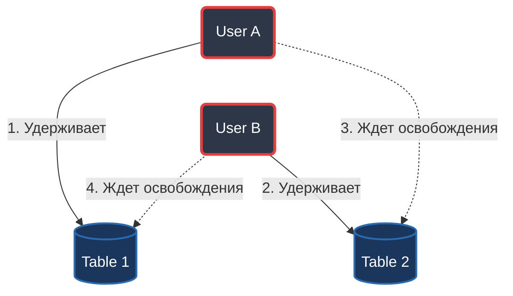

# Базы данных
## Преподаватель

> **Склеймин Юрий Броисович**
>
> 📞 `[номер удалён]`  
> ✉️ `[email удалён]`

Нечетная неделя: базовый уровень\
Четная: продвинутый уровень
## 09 сентября. Лекция
Relation - отношения\
Реляционные базы данных - таблицы отношений


### Файловая система
В отличие от бд файловая система хранит не структурированный данные.

> Файл - именованная область памяти с возможностью чтения и записи данных.

Файловая система обеспечивает контроль доступа к файлам. 

Надежность - от случайных угроз.
Безопасность - от человеческий угроз. 

Надежность и безопасность обеспечивается резервным копированием, RAID
Режим многопользовательского доступа


### Таблицы 
#### Типы данных в SQL
| Тип | Описание |
| -- | -- |
| `char` | последовательность символов заданной длины |
| `varchar` | последовательность символов изменяемой длины | 
| `int` | Целое число |
| `serial` | Порядковый номер в таблице |

На примере паспорта
| uuid  | fam | nam | otc | street | bldn | bldn_r | appr | telef |
| --  | -- | -- | -- | -- | -- | -- | -- | -- |
| serial | char(30) | char(30) | char(30) | char(30) | char(10) | char(10) | int | char(30) |
| 1 | Иванов | Иван | Иванович | Ленина | 17 | 3 | 111 | 8(800)555-35-35 | 

Так как фамилии могут повторяться, сделаем отдельную таблицу для фамилий:

| f_id | f_name |
| -- | -- |
|1 | Иванов | 

В первой таблице заменим поле с фамилией на идентификатор фамилии.
Так же в отдельные таблицы можно вынести и некоторые другие поля. 

### Связь таблиц
* **Родительская таблица** содержит уникальный идентификатор (Primary Key).

* **Дочерняя таблица** (Зависимая) содержит внешний ключ (Foreign Key), который ссылается на родительскую таблицу, и хранит производные или связанные данные.

### Операции с таблицами

### DELETE
Удаление записи
* **`RESTRICT` (Ограничение)**  
  Запрещает удаление строки из родительской таблицы, если в дочерней таблице есть хотя бы одна связанная с ней строка.
  
* **`CASCADE` (Каскадное удаление)**  
  При удалении строки из родительской таблицы СУБД автоматически удаляет все связанные строки из дочерних таблиц.
  
* **`SET NULL` (Установка в NULL)**  
  Заменяет значение внешнего ключа в дочерней таблице на `NULL`, если связанная строка в родительской таблице была удалена. *Требует, чтобы для столбца не стояло ограничение `NOT NULL`.*

* **`NO ACTION` (Без действия / Отложенная проверка)**  
  По умолчанию ведет себя как `RESTRICT` и запрещает удаление родительской строки при наличии связанных дочерних. Однако, в отличие от `RESTRICT`, позволяет отложить проверку целостности на самый конец транзакции (`COMMIT`).


### UPDATE 
Обновление существующего значения 
* **`RESTRICT` (Ограничение)**  
  Запрещает обновление строки из родительской таблицы, если в дочерней таблице есть хотя бы одна связанная с ней строка.
  
* **`CASCADE` (Каскадное удаление)**  
  При обновлении строки из родительской таблицы СУБД автоматически обновляет все связанные строки из дочерних таблиц.
  
* **`SET NULL` (Установка в NULL)**  
  Заменяет значение внешнего ключа в дочерней таблице на `NULL`, если связанная строка в родительской таблице была обновлена. *Требует, чтобы для столбца не стояло ограничение `NOT NULL`.*

* **`NO ACTION` (Без действия / Отложенная проверка)**  
  По умолчанию ведет себя как `RESTRICT` и запрещает удаление родительской строки при наличии связанных дочерних. Однако, в отличие от `RESTRICT`, позволяет отложить проверку целостности на самый конец транзакции (`COMMIT`).

### INSERT
Добавление новых значений в таблицу
* **`RESTRICT` (Ограничение)**  
  Запрещает вставлять строку в дочернюю таблицу, если указанного идентификатора (ID) еще нет в родительской таблице.

* **`SET NULL` (Установка в NULL)**
    СУБД позволяет вставить строку в дочернюю таблицу с пустым внешним ключом (`NULL`).

* **`NO ACTION` (Без действия / Отложенная проверка)**  
    Позволяет временно вставить запись в дочернюю таблицу с указанием еще не существующего родительского ID. Проверка связи переносится на момент завершения транзакции (`COMMIT`), к которому родительская строка уже обязана быть создана.

## 19 Сентября. Практика
**Создание таблиц**
```sql
CREATE TABLE nam (
    u_id SERIAL PRIMARY KEY,
    n_val VARCHAR(50) NOT NULL
);

CREATE TABLE fam (
    u_id SERIAL PRIMARY KEY,
    f_val VARCHAR(50) NOT NULL
);

CREATE TABLE otc (
    u_id SERIAL PRIMARY KEY,
    o_val VARCHAR(50) NOT NULL
);

CREATE TABLE street (
    u_id SERIAL PRIMARY KEY,
    s_val VARCHAR(50) NOT NULL
);

CREATE TABLE people (
    u_id SERIAL PRIMARY KEY,
    fam INT REFERENCES fam(u_id),
    nam INT REFERENCES nam(u_id),
    otc INT REFERENCES otc(u_id),
    street INT REFERENCES street(u_id),
    bldn VARCHAR(5),
    bldn_k VARCHAR(5),
    appr INT,
    telef_n VARCHAR(30)
);
```
**Вывод объединённой таблицы**
```sql
SELECT people.u_id, fam.f_val, nam.n_val, otc.o_val, street.s_val, people.bldn, people.bldn_k, people.appr, people.telef_n
FROM people
    JOIN fam ON people.fam = fam.u_id
    JOIN nam ON people.nam = nam.u_id
    JOIN otc ON people.otc = otc.u_id
    JOIN street ON people.street = street.u_id
```  


**`cross join`** – перекрестное соединение
Возвращает все возможные комбинации сочетаний значений (декартово произведение).

| *table 1* | *table 2* |
| -- | -- |
|**name**|**surname**|
| Иван | Иванов|
| Петр | Петров|


```sql
SELECT n.name, s.surname
FROM name n
CROSS JOIN surname s ORDER BY n.name ASC
```
**Результат выполнения:**

| name | surname |
|------|---------|
| Иван | Иванов  |
| Иван | Петров  |
| Петр | Иванов  |
| Петр | Петров  |


## 23 Сентября. Лекция

`База данных` - компьютеризированная система хранения записей наподобие электронной картотеки.

**Преимущества:**
* Компактность 
* Быстродействие 
* Трудозатраты 
* Актуальность 
* Защита

**Компоненты БД:** 
* данные
* аппаратное обеспечение (накопители, контроллеры, процессоры)
* программное обеспечение
* пользователи 

`Реляционная система` – система хранения данных в виде связанных таблиц.

Отношение S

| S# | ST_FAM | ST_NAME | AV_CNT |
| -- | -- | -- | -- |
| S1 | Степанов | Руслан | 4.1 |
| S2 | Иванов | Иван | 3.8 |
| S3 | Смирнов | Сергей | 4.18 |

**Основные термины:**  
`Первичный ключ` - S1, S2, S3...  
`Атрибуты` – столбцы таблицы. ST_FAM, ST_NAME...  
`Кортеж` - строка таблицы  
`Кардинальное число` – количество кортежей  
`Степень` – количество атрибутов  
`Домен` – пользовательский тип данных, на основе базового типа и накладывает дополнительные ограничения на допустимые значения


**Основные подсистемы ядра СУБД:** 

* Ввод - Вывод
* Безопасность
* Процессор языка программирования
* Управление хранением данных
* Ведение журналов и восстановление
* Контроль распределенных операций
* Управление транзакциями 
* Управление блокировками 
* Управление памятью

`Транзакция` – совокупность операций, которые должны либо выполнится успешно, либо не выполниться вовсе.  
**ACID**
* `Atomicity` – атомарность транзакций. Либо применяются все изменения, либо ни одного. 
* `Consistency` – транзакции не нарушают согласованность данных. То есть переводят бд из одного корректного состояние в другое. 
* `Isolation` – одновременные транзакции не влияют друг на друга. Многопоточно выполняются так же, как выполнились бы последовательно
* `Durability` – если транзакция была успешно применена, то внешнее воздействие не должно привести к потере изменений.


`DEADLOCK` – взаимная блокировка запрашиваемых ресурсов:  
USER A -> запрос блокировки TABLE 1 -> запрос блокировки TABLE 2  
USER B -> запрос блокировки TABLE 2 -> запрос блокировки TABLE 1  

**Варианты решения:**
* Ограничение по времени
* Графы связей

### ODBC (Open Database Connectivity) 
 **ODBC** – это универсальный API для доступа к базам данных, который позволяет программам работать с различными СУБД через единый набор команд.  

 ODBC нужен для того, чтобы отвязать код приложения от конкретной базы данных. Без него разработчикам пришлось бы писать отдельный код для взаимодействия с каждой СУБД. Приложение может отправлять стандартные SQL-запросы, которые будут одинаково работать с PostgreSQL, MySQL, Oracle или SQL Server.


## 21 октября. Лекция
### Типы данных
**Основные*
* Десятичные числа – числа, имеющие дробную часть, но которые нужно вычислять точно. Имеют размер числа.
* Число с плавающей запятой – величины, которые можно вычислять приблизительно. Значения весов и расстояний.
* Длинный текст
* Дата и время – единый тип для даты и времени

**Геометрические типы данных**
* circle
* polygone
и тд

**Остальные типы данных:**
* json
* jsonb 
* uuid 
* xml

### SELECT 
`SELECT` – запрос для получения данных, без их изменения. Может сочетаться с операторами для фильтрации. 
```sql
SELECT * {DISTINCT | ALL }
FROM {<имя таблицы>}, ...
[WHERE <предикат>]
[GROUP BY {<имя столбца> | <целое>}, ...]
[HAVING <предикат>]
[ORDER BY {<имя столбца> | <целое>}, ...]
```


| Часть	| Назначение| 
| -- | -- |
| `SELECT` | 	какие столбцы/выражения вернуть |
| `DISTINCT` | 	убрать полностью одинаковые строки результата |
| `ALL` | 	оставить все строки; используется по умолчанию |
| `FROM` | 	из каких таблиц брать данные |
| `WHERE` | 	фильтрация строк до группировки |
| `GROUP BY` |	разбиение строк на группы| 
| `HAVING` | 	фильтрация групп после группировки |
| `ORDER BY` | сортировка результата |

## WHERE, GROUP BY, HAVING

### WHERE
- Фильтрует **строки** до группировки.
- Нельзя использовать агрегатные функции (`COUNT`, `SUM`, `AVG`, `MIN`, `MAX`).
- Можно использовать `AND`, `OR`, `IN`, `BETWEEN`, `LIKE`, `IS NULL`.

**Пример `WHERE`**

```sql
SELECT *
FROM Students
WHERE age >= 17 AND group_id = 101;
```

**Результат:**
id | name | age | group_id
---|------|-----|---------
1  | Анна | 18  | 101
4  | Пётр | 17  | 101


### GROUP BY
- Группирует строки по одному или нескольким столбцам.
- Нужен для агрегатных функций.
- Если в SELECT есть неагрегированный столбец, он обычно должен быть в GROUP BY.

**Пример `GROUP BY`**
```sql
SELECT group_id, COUNT(*) AS cnt
FROM Students
GROUP BY group_id;
```

**Результат:**
group_id | cnt
---------|----
101      | 3
102      | 2
103      | 1

### HAVING

- Фильтрует группы после GROUP BY.
- Можно использовать агрегатные функции.
- Применяется после группировки, в отличие от WHERE.

**Пример `HAVING`**
```sql
SELECT group_id, COUNT(*) AS cnt
FROM Students
GROUP BY group_id
HAVING COUNT(*) > 10;
```
**Результат:**
group_id | cnt
---------|----
101      | 3

