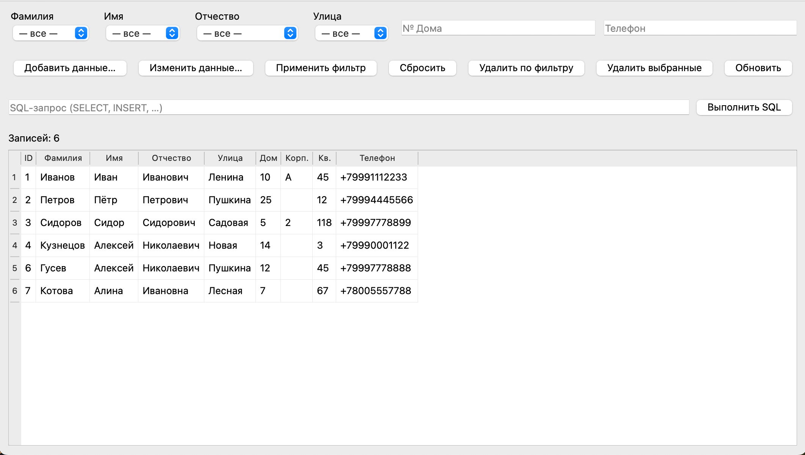
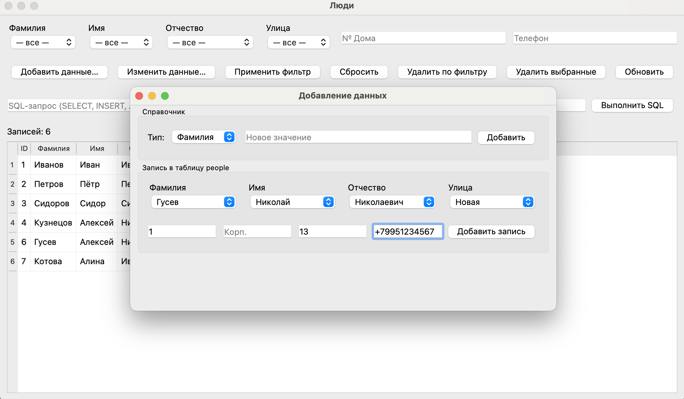
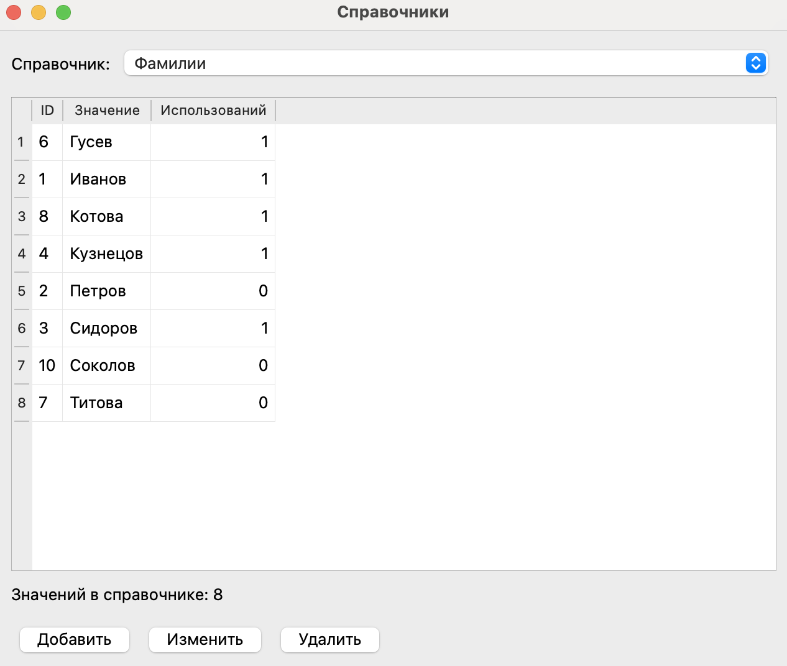

# Практическое задание — клиент PostgreSQL (PyQt5 + pyodbc)

Десктопное приложение для работы с базой «адресная книга».

## 🚀 Установка и запуск

### 1. Клонирование репозитория

```bash
git clone https://github.com/realINL/MAI_DB.git
cd Practice2
```

### 2. Создание виртуального окружения

**Linux / macOS:**
```bash
python3 -m venv .venv
source .venv/bin/activate
```

**Windows (cmd):**
```cmd
python -m venv .venv
.venv\Scripts\activate.bat
```

### 3. Установка зависимостей

```bash
pip install -r requirements.txt
```

### 4. Запуск

```bash
cd app
python main.py
```


1. В окне **SQL Connection** укажите параметры подключения и нажмите **Connect**
   (значения по умолчанию можно поправить, они же читаются из `app/.env`).
2. Откроется главное окно **Люди** с таблицей записей.

## 📚 Схема базы

| Таблица   | Назначение                          |
|-----------|-------------------------------------|
| `fam`     | Фамилии (`u_id`, `f_val`)           |
| `nam`     | Имена (`u_id`, `n_val`)             |
| `otc`     | Отчества (`u_id`, `o_val`)          |
| `street`  | Улицы (`u_id`, `s_val`)             |
| `people`  | Запись человека: FK на справочники + дом, корпус, квартира, телефон |

Создание таблиц: [CreateTable.sql](../queries/PracticePeople/CreateTable.sql)

## ⚒️ Как устроено приложение

### Структура проекта

| Файл               | Роль |
|--------------------|------|
| `app/main.py`      | Точка входа: `QApplication` + окно подключения |
| `app/ConnectWindow.py` | Форма параметров ODBC-подключения |
| `app/MainWindow.py` | Главный экран: фильтры, таблица, SQL, удаление |
| `app/AddDataWindow.py` | Окно добавления в справочники и в `people` |
| `app/EditDataWindow.py` | Окно редактирования справочников |
| `app/db.py`        | Слой доступа к БД (pyodbc) |

Один экземпляр `Database` передаётся во все окна; после подключения хранится общее `connection` и `cursor`.

---

### Главное окно



- **Фильтры** — по значениям справочников (`fam`, `nam`, `otc`, `street`), а также по номеру дома и телефону.
- **Применить фильтр / Обновить** — запрос `fetch_people()` с `JOIN` справочников; в таблице показываются текстовые значения, а не сырые FK. Телефон фильтруется регулярным выражением (`~`).
- **Сбросить** — очищает все фильтры и обновляет таблицу.
- **Удалить по фильтру** — `DELETE FROM people` с условиями по четырём справочникам; нужен **хотя бы один** выбранный фильтр (защита от удаления всей таблицы).
- **Удалить выбранные** — удаление по `u_id` выделенных строк; работает только в режиме таблицы `people`.
- **Добавить данные…** — открывает `AddDataWindow`; после вставки главное окно обновляет справочники и таблицу через колбэк `on_data_changed`.
- **Изменить данные…** — открывает `EditDataWindow` (редактирование справочников); изменения также применяются к главному окну через `on_data_changed`.
- **SQL-поле** — произвольный запрос через `execute_sql()`:
  - `SELECT` — результат в таблице, заголовки из метаданных курсора;
  - команды без результата (`INSERT`, `UPDATE`, `DELETE`, …) — выполняются с `commit`, число затронутых строк в статусной строке.

После выполнения произвольного `SELECT` таблица переходит в **режим SQL**: кнопка «Удалить выбранные» предложит вернуться к данным `people` через «Обновить» или «Применить фильтр». «Удалить по фильтру» по-прежнему удаляет из `people` в БД, даже если на экране другой результат.

### Окно добавления данных



- Блок **Справочник** — выбор типа (`fam` / `nam` / `otc` / `street`), ввод строки, `INSERT … RETURNING u_id`. После добавления значение сразу выбирается в соответствующем комбобоксе.
- Блок **people** — обязательный выбор четырёх FK в комбобоксах; дом, корпус, квартира, телефон необязательны (пустые поля → `NULL`). Квартира (`appr`) должна быть целым числом.

### Окно редактирования справочников



- Выбор справочника (`fam` / `nam` / `otc` / `street`) и таблица значений с колонкой **Использований** — количество записей `people`, ссылающихся на значение.
- **Добавить** / **Изменить** — вставка и изменение значения выбранного справочника (двойной клик по строке также открывает изменение).
- **Удалить** — если значение не используется, удаляется из справочника. Если оно используется, приложение спрашивает: «Удалить все связанные данные из таблицы people?». При подтверждении сначала удаляются связанные записи `people`, затем само значение; при отказе удаление отменяется.

### Слой `db.py`

- Параметризованные запросы (`?`) для фильтров, вставок и удалений — снижает риск SQL-инъекций в штатных операциях.
- Имена таблиц и колонок в доменных методах **зашиты** под учебную схему (`LOOKUP_COLUMNS`, `PEOPLE_SELECT`).
- `execute_sql()` выполняет **любой** текст запроса без параметризации — ответственность за корректность и безопасность на пользователе.

## ⛓️ Зависимости

- `pyodbc` — ODBC
- `PyQt5` — интерфейс
- `python-dotenv` — переменные окружения из `.env`
