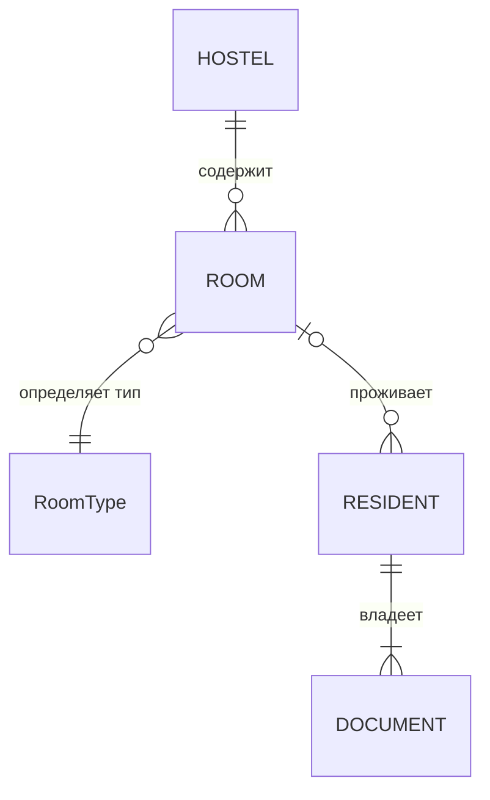
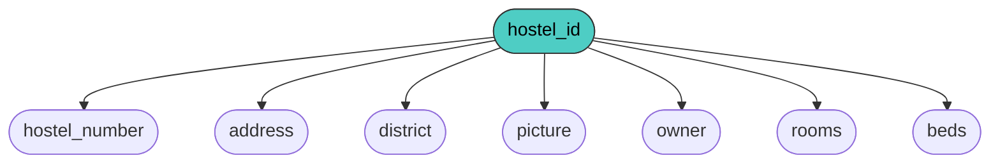
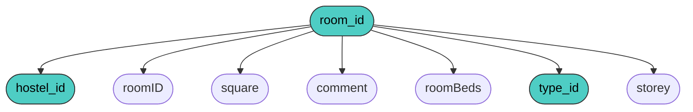
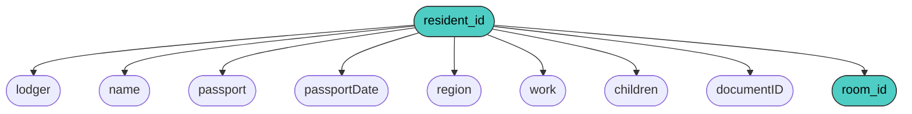
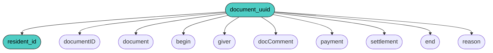
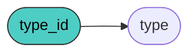
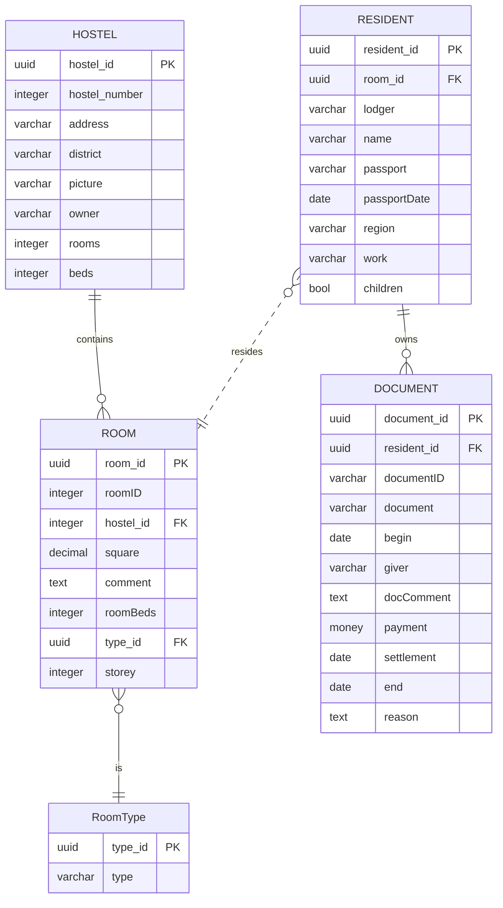
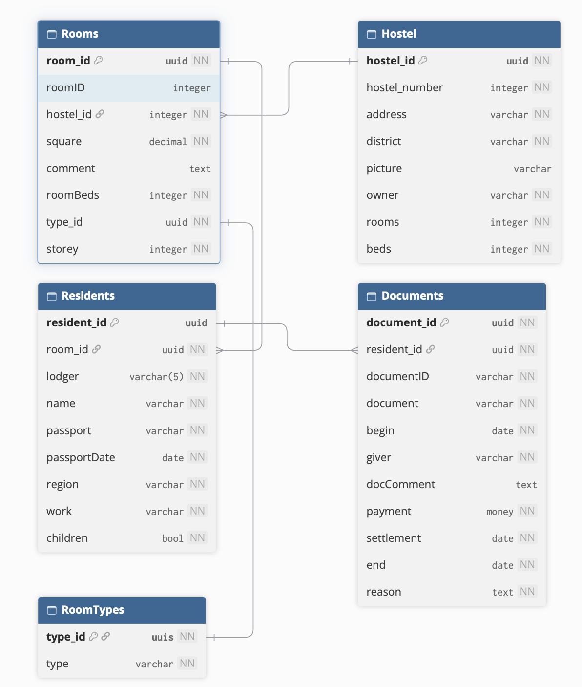

# Лабораторная работа №2
## Задание  
>Разработать прикладное программное обеспечение деятельности отдела заселения муниципальных общежитий администрации города. В ведении администрации города находится несколько десятков общежитий. Раньше они принадлежали предприятиям города, а теперь, после банкротства предприятий, все эти общежития переданы муниципальным властям. В последние годы бесплатные квартиры гражданам города практически не предоставляются, а количество малоимущих жителей, нуждающихся в жилье, растет. Хоть как-то улучшить жилищные условия этой категории граждан позволяет наличие муниципальных общежитий. Получить четкую картину их заселения позволит данное программное обеспечение. База данных отдела содержит информацию об общежитиях, комнатах общежитий и проживающих.  
>
**Набор данных**  
| Поле | Тип | Размер | Описание |
| -- | -- | :---: | -- |
| `Hostel` | Числовой | 5| Номер общежития |
| `Address` | Текстовый | 60 | Адрес общежития |
| `District` | Текстовый | 15 | Район города, в котором расположено |
| `Picture` | Поле OLE | Авто |  Фотография общежития |
| `Owner` | Текстовый | 20 | Балансодержатель |
| `Rooms` | Числовой | 4 |  Комнат в общежитии |
| `Beds` | Числовой | 5 |  Количество койко-мест в общежитии |
| `RoomID` | Числовой | 4 | Номер комнаты |
| `Square` | Числовой | 10 |  Площадь комнаты |
| `Comment` | Поле Меmо | Авто | Примечания |
| `RoomBeds` | Числовой | 2 |  Количество койко-мест в комнате |
| `Type` | Числовой | 1 |  Тип комнаты (одноместная и т.д.) |
| `Storey` | Числовой | 2 | Номер этажа |
| `Lodger` | Числовой | 5 |Регистрационный номер жильца |
| `Name` | Текстовый | 40 |  ФИО жильца |
| `Passport` | Текстовый | 20 |  Номер паспорта |
| `PassportDate` | Дата | Авто | Дата выдачи паспорта |
| `Region` | Текстовый | 40 | Кем выдан паспорт |
| `Work` | Текстовый | 20 |  Место работы или учебы |
| `Children` | Логический | 1 |  С детьми (да/нет) |
| `DocumentID` | Числовой | 5 |Номер документа на заселение |
| `Document` | Текстовый | 20 |  Название документа на заселение |
| `Begin` | Дата | Авто | Начало действия документа |
| `Giver` | Текстовый |20  |  Кем выдан документ на заселение |
| `DocComment` | Поле Меmо |Авто |  Комментарий |
| `Payment` | Денежный | Авто | Плата за проживание в месяц |
| `Settlement` | Дата | Авто |Дата заселения в общежитие |
| `End` | Дата |  Авто | Дата выселения из общежития |
| `Reason` | Поле Меmо | Авто |  Причина выселения |

## Решение

### 1. Концептуальная модель (ER-диаграмма)
На основе анализа предметной области выделены следующие сущности и их отношения: 

### 2. Логическая модель (Применение правил Джексона)
Преобразование модели «сущность-связь» в систему отношений выполняется по алгоритму Джексона.

1. **1:1, класс принадлежности обеих сущностей обязательный** — достаточно одного отношения; первичным ключом может служить ключ любой из сущностей.
2. **1:1, у одной сущности класс принадлежности обязательный, у другой — необязательный** — два отношения (по одному на сущность); ключ необязательной сущности добавляется как атрибут в отношение обязательной сущности.
3. **1:1, класс принадлежности обеих сущностей необязательный** — три отношения: по одному на каждую сущность и одно для связи; отношение связи содержит ключи обеих сущностей.
4. **1:n, класс принадлежности n-связной сущности обязательный** — два отношения (по одному на сущность); ключ 1-связной сущности добавляется как атрибут в отношение n-связной сущности.
5. **1:n, класс принадлежности n-связной сущности необязательный** — три отношения: по одному на каждую сущность и одно для связи; отношение связи содержит ключи обеих сущностей.
6. **m:n** — три отношения: по одному на каждую сущность и одно для связи; отношение связи содержит ключи обеих сущностей.

**Применение правил к данной схеме**

| Связь | Степень | Класс принадлежности | Правило | Обоснование | Результат |
| :--- | :---: | :--- | :---: | --- | -- |
| `HOSTEL` — `ROOM` | 1:n | `ROOM` обязательный | 4 | Комната не может существовать без общежития | **FK** `hostel_id` добавляется в отношение `ROOM`  |
| `RESIDENT` — `DOCUMENT` | 1:n | `DOCUMENT` обязательный | 4 | Резидент может получить несколько документов на заселение | **FK** `resident_id` добавляется в отношение `DOCUMENT` |
| `ROOM` — `RESIDENT` | 1:n | `RESIDENT` необязательный | 5 | Резидент может числиться в базе и после выселения | **FK** `room_id` добавляется в отношение `RESIDENT` и может быть `NULL`|
| `RoomType` - `ROOM` | 1:n  | `RoomType` обязательный | 4 | Комната всегда имеет тип | **FK** `type_id` добавляется в отношение `ROOM`  |

**Итоговый набор отношений, получаенный по правилам Джексона:**

* `HOSTEL` — **PK** `hostel_id`
* `RoomType` - **PK** `type_id`
* `ROOM` — **PK** `room_id`, **FK** `hostel_id`, **FK** `type_id`
* `RESIDENT` — **PK** `resident_id`, **FK** `room_id`
* `DOCUMENT` — **PK** `document_uuid`, **FK** `resident_id`

**На основе полученных отношений построим диаграмму фз:**
### 3. Диаграммы функциональных зависимостей (ФЗ)

**Hostel**

**Room**

**Resident**

**Document**

    
**Type**

**На основе построенной диаграммы построим схему:**
### 4. Итоговая схема базы данных

